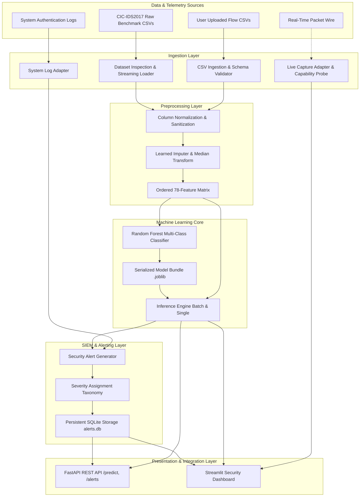

# System Architecture & Technical Design

## 1. Architectural Overview

The **AI-Powered Intrusion Detection System (AI-IDS)** is organized into decoupled, single-responsibility modules following clean engineering principles. The architecture separates offline model preparation from online inference, and segregates heterogeneous telemetry sources (network flows vs. system authentication logs) into dedicated ingestion adapters.

---

## 2. Layer-by-Layer Architectural Breakdown

### A. Ingestion Layer (`src/ai_ids/ingestion/`, `src/ai_ids/datasets/`)
- **`datasets/inspection.py`:** Performs non-destructive chunked auditing of raw benchmark files, computing SHA-256 checksums, counting records, verifying column schema consistency, and tallying NaN and infinity instances.
- **`datasets/loader.py`:** Implements memory-bounded streaming across CSVs, enforcing class-balanced sub-sampling to respect the 12 GB RAM constraint.
- **`ingestion/csv_ingest.py`:** Inspects user-uploaded CSV headers, calculates the matching ratio against canonical features (requiring >= 50% compatibility), and reports schema diffs.
- **`ingestion/log_adapter.py`:** Dedicated parser for system logs (SSH authentication). Employs regex pattern matching to track source IP failure frequencies and triggers correlated Brute-Force alerts once thresholds are breached.
- **`ingestion/live_capture.py`:** Network sniffer adapter interface. Queries OS socket capabilities, tracks 5-tuple bi-directional flows, and transparently reports privilege status on Windows.

> [!IMPORTANT]
> **Telemetry Separation Boundary:**  
> Textual system logs and raw PCAP bytes are NOT directly concatenated or passed as model features into the network-flow model. Network flows represent numerical duration and packet volume statistics, whereas system logs represent authentication states. Mixing them into a single tabular matrix causes dimensional mismatch and data corruption.

### B. Preprocessing Layer (`src/ai_ids/preprocessing/`)
- **`preprocessing/cleaner.py`:**
  - Strips leading/trailing whitespace from column names and string labels.
  - Normalizes label variations (e.g. mapping `Web Attack \ufffd Brute Force` to `Web_Attack`).
  - Identifies infinities (`np.inf`, `-np.inf`) and replaces them with `np.nan`.
- **`preprocessing/pipeline.py` (`IDSPreprocessor`):**
  - Maintains strict versioned list of 78 canonical flow features in reproducible order.
  - Fits median values **only on the training split** to prevent data leakage.
  - Transforms inference records into clean `float32` matrices.

### C. Model Training & Evaluation Layer (`src/ai_ids/models/`)
- **`models/trainer.py`:** Trains a multi-class Scikit-learn `RandomForestClassifier` (`n_estimators=100`, `max_depth=16`, `n_jobs=-1`). Serializes the model, preprocessor, schema, and training metadata into a unified `.joblib` bundle.
- **`models/evaluator.py`:** Computes multi-class and binary metrics: Accuracy, Precision, Recall, F1, Confusion Matrix, False Positive Rate (FPR), False Negative Rate (FNR), and single/batch latency benchmarks.

### D. Inference Engine (`src/ai_ids/inference/`)
- **`inference/engine.py`:**
  - Loads the pre-trained model bundle.
  - Executes batch inference on DataFrames or single-record inference on individual flow dictionaries.
  - Computes class predictions, maximum confidence scores, and probability of attack (`1.0 - P(BENIGN)`).
  - Automatically triggers structured `SecurityAlert` generation and persists alerts into SQLite.

### E. Alert & Storage Layer (`src/ai_ids/alerts/`, `src/ai_ids/storage/`)
- **`alerts/schema.py`:** Pydantic model enforcing validated SIEM attributes (`alert_id`, `timestamp`, `source`, `flow_index`, `prediction`, `attack_type`, `confidence_score`, `severity`, `features_snapshot`, `is_mitigated=False`).
- **`alerts/generator.py`:** Evaluates prediction outcomes and applies the severity taxonomy (`CRITICAL`, `HIGH`, `MEDIUM`, `INFO`).
- **`storage/db.py`:** SQLite database wrapper (`data/alerts.db`) featuring structured tables and B-tree indexes on timestamp, severity, attack type, and source.

### F. API & Dashboard Layer (`src/ai_ids/api/`, `app/dashboard.py`)
- **`api/server.py`:** FastAPI application exposing RESTful JSON endpoints with CORS support.
- **`dashboard.py`:** Streamlit graphical operations console featuring a cybersecurity dark mode, interactive flow upload, KPI metrics, bar charts, downloadable CSV reports, and SIEM alert audit logs.
